# Semana 3 — Functional Proof

**Proyecto:** MicoPay — cambiar dinero digital por pesos en efectivo con alguien de tu colonia, sin tener que confiar primero en un desconocido.

**Red:** Stellar testnet.

---

## 1. Front construido

El front es una app web hecha con React 19, Vite y TypeScript. Con Capacitor se empaqueta como app Android, que es como la usan hoy los testers. Vive en la carpeta `micopay/frontend/` de este repositorio y cubre de punta a punta el flujo de retiro (cash-out) del Product Blueprint: el usuario cambia USDC por efectivo con un comercio cercano, sin que ninguno de los dos tenga que confiar primero en el otro.

Para correrlo contra el backend de testnet (Node.js 20 o superior):

```sh
cd micopay/frontend
npm install
npm run dev -- --mode testnet
```

y abrir http://localhost:5181.

Esta semana no empezamos desde cero. La interfaz viene del prototipo que el equipo ya tenía funcionando en red de prueba. Con ese prototipo hicimos un retiro y un depósito de $500 MXN de punta a punta el 24 de septiembre de 2026, y un ensayo del escrow en USDC el 7 de octubre. El trabajo de la semana fue ordenar ese front contra el MVP del Blueprint y documentarlo.

**Enlace al front funcionando:** [pendiente: URL de Vercel]

### Pantallas del flujo principal del MVP

La tabla sigue el orden en que una persona recorre la app y lo conecta con los pasos del flujo de usuario del Blueprint (sección 3).

| # | Pantalla (archivo en `micopay/frontend/src/pages/`) | Qué ve y hace la persona | Paso del Blueprint |
| :---: | --- | --- | :---: |
| 1 | Registro e inicio de sesión (`Register.tsx`, `Login.tsx`) | Crea su cuenta. La llave de su billetera Stellar se genera y se guarda en el teléfono. Antes de continuar, un aviso le pide respaldar su llave secreta y confirmar que lo hizo (`SecretKeyBackupModal`). | 1 |
| 2 | Inicio (`Home.tsx`) | Ve su saldo, sus intercambios recientes y los botones para retirar o depositar efectivo. | 1 |
| 3 | Monto (`CashoutRequest.tsx`) | Escribe cuántos pesos en efectivo quiere recibir. | 3 |
| 4 | Mapa de comercios (`ExploreMap.tsx`) | Ve en un mapa real (MapLibre) los comercios cercanos que tienen efectivo. Cada tarjeta muestra la comisión del comercio y su número de intercambios completados, y la persona elige uno. | 2 |
| 5 | Confirmación (`TradeConfirmation.tsx`) | Ve el desglose antes de comprometer su dinero: pesos que recibe, comisión del comercio, comisión de plataforma y total que sale de su saldo. El servidor calcula el desglose y la pantalla solo lo muestra, para que no haya diferencias entre lo que se ve y lo que se cobra. | 3 |
| 6 | Firma (`SignatureApproval.tsx`) | Autoriza la operación en su teléfono. Con esa firma, los USDC quedan bloqueados en el contrato de escrow con un plazo de vencimiento. | 3–4 |
| 7 | Chat con el comercio (`ChatRoom.tsx`) | Coordina con el comercio la entrega del efectivo mientras el dinero ya está bloqueado. | 4–5 |
| 8 | Código QR (`QRReveal.tsx`) | Al recibir el efectivo, muestra el QR de un solo uso. Solo aparece mientras el intercambio está activo. | 6 |
| 9 | Bandeja y escáner del comercio (`MerchantInbox.tsx`) | El comercio ve las solicitudes que le llegan, escanea el QR del usuario con la cámara y confirma la entrega. El contrato libera los USDC a su cuenta. | 7 |
| 10 | Intercambio completado (`SuccessScreen.tsx`) | Ambos ven el intercambio como terminado, con el enlace a la transacción en el explorador de Stellar. | 8 |
| 11 | Historial y detalle (`History.tsx`, `TradeDetail.tsx`) | Lista de intercambios con su estado: bloqueado, completado, expirado o reembolsado. Si el plazo venció sin entrega, desde aquí se pide la devolución de los USDC. | 8 y 8b |
| 12 | Alta y ajustes del comercio (`ProviderOnboarding.tsx`, `MerchantSettings.tsx`) | Una persona o comercio se registra como punto de efectivo y configura su comisión. Es la "comisión configurable por comercio" del alcance del MVP. | Alcance del MVP |

### Capturas (app Android en testnet, 15 de octubre de 2026)

Las capturas se tomaron con una cuenta registrada como agente (`agente_xalapa`). Llegan hasta la búsqueda de comercios. En esa prueba ningún otro agente cercano tenía liquidez para $500 MXN, así que el flujo se detuvo antes de la confirmación.

**Flujo de retiro (pasos 1 a 4 de la tabla)**

| Iniciar sesión | Inicio | Monto | Monto y búsqueda |
| :---: | :---: | :---: | :---: |
| 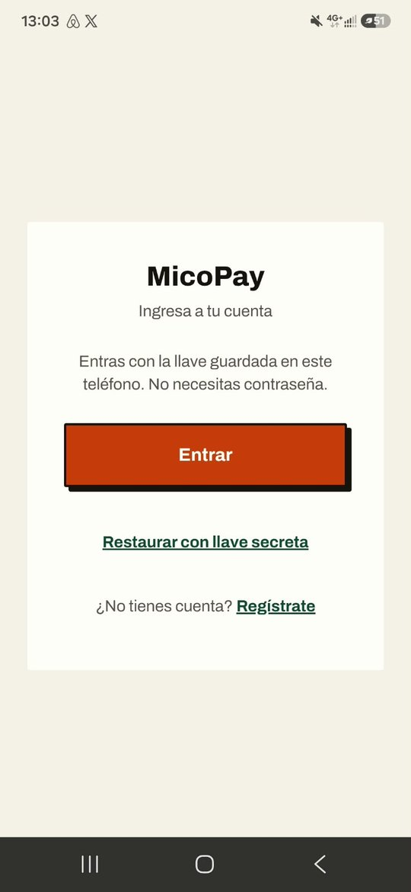 | 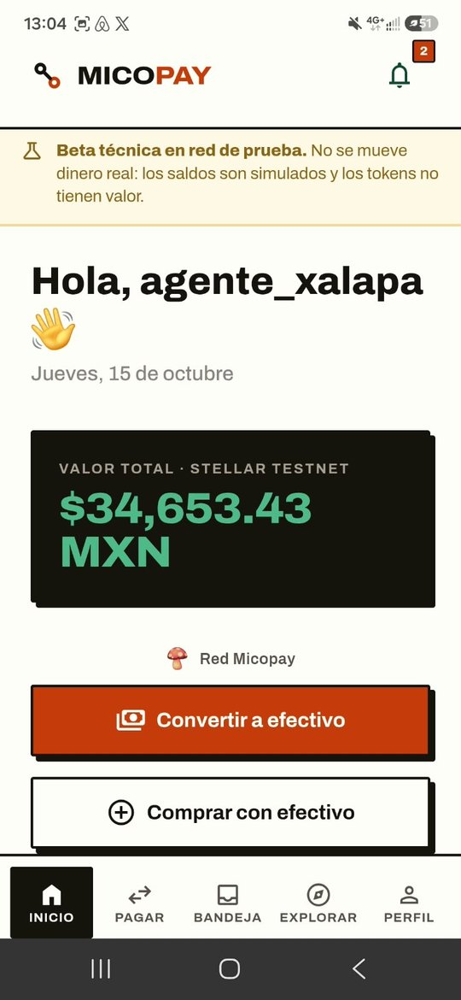 | 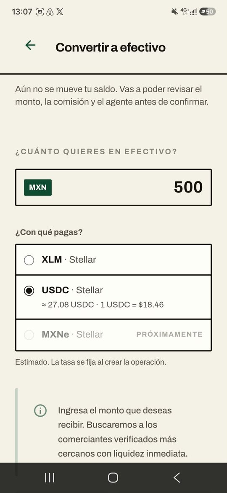 | 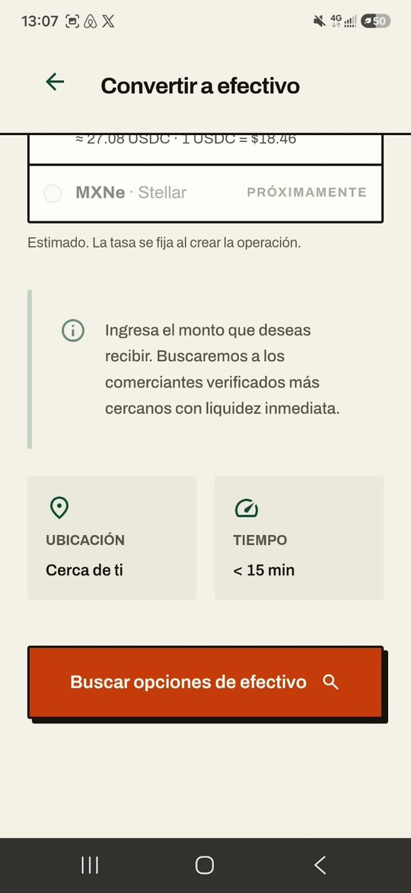 |

| Buscando agentes | Mapa de comercios | Sin agentes disponibles |
| :---: | :---: | :---: |
| 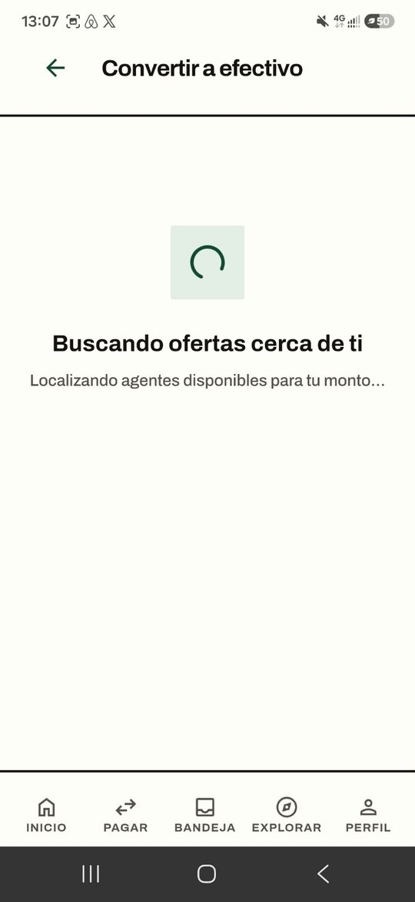 | 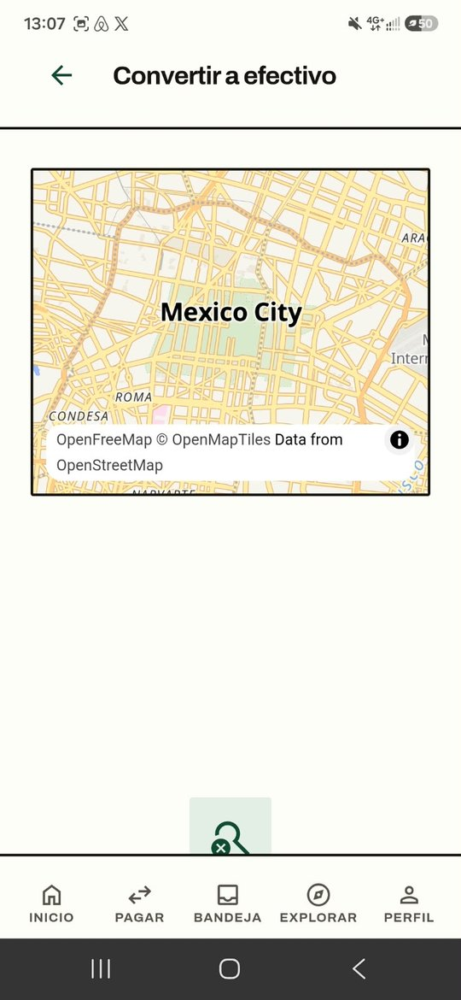 | 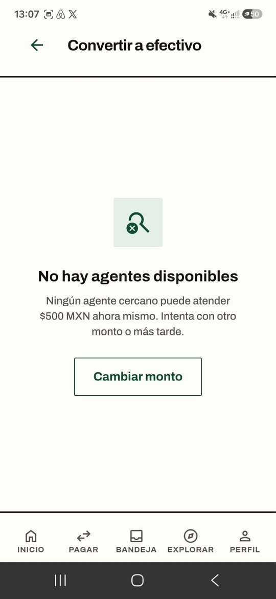 |

La pantalla de inicio de sesión no pide contraseña: se entra con la llave guardada en el teléfono o se restaura con la llave secreta. En el monto, la app muestra cuántos USDC equivale el retiro y el tipo de cambio estimado antes de buscar comercios. Si nadie puede atender el monto, la app lo dice y ofrece cambiarlo.

**Lado del comercio y cuenta (pasos 9 y 12 de la tabla)**

| Bandeja del comercio | Perfil | Red MicoPay (agente) |
| :---: | :---: | :---: |
| 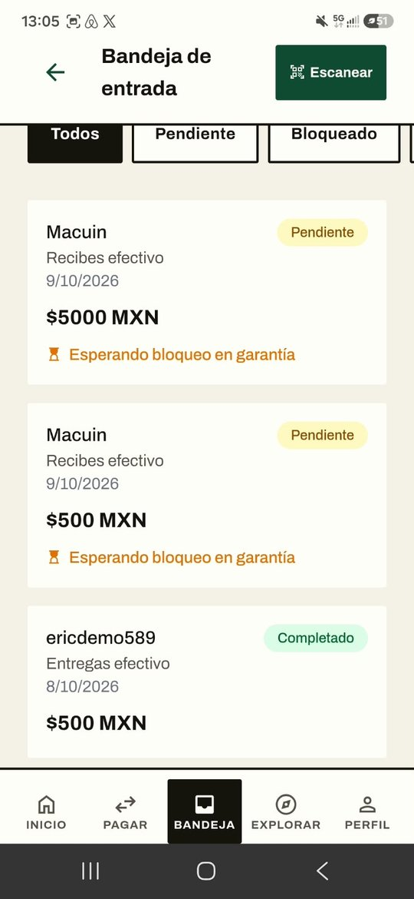 | 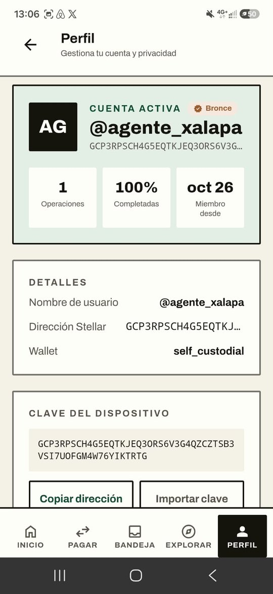 | 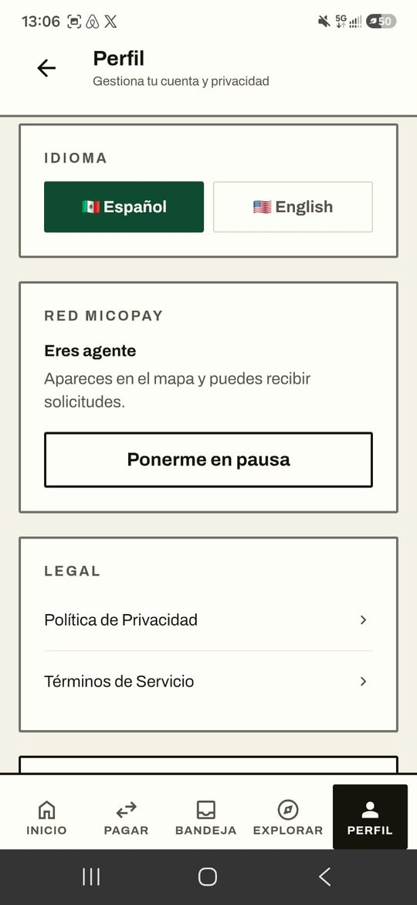 |

La bandeja muestra las solicitudes que recibe el comercio con su estado (pendiente, esperando bloqueo en garantía, completado) y el botón para escanear el QR. En el perfil se ven la billetera *self-custodial*, el número de operaciones y el porcentaje completado, que es la reputación del comercio, además de la opción de pausarse como agente en el mapa.

**Otras pantallas (fuera del MVP)**

| Pagar | Recibir | Explorar | Eliminar cuenta |
| :---: | :---: | :---: | :---: |
| 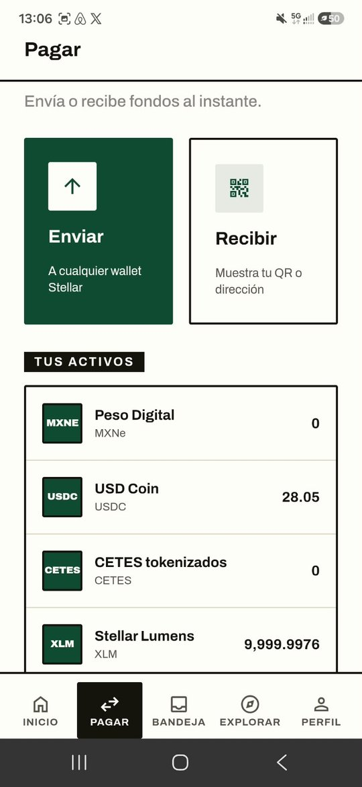 | 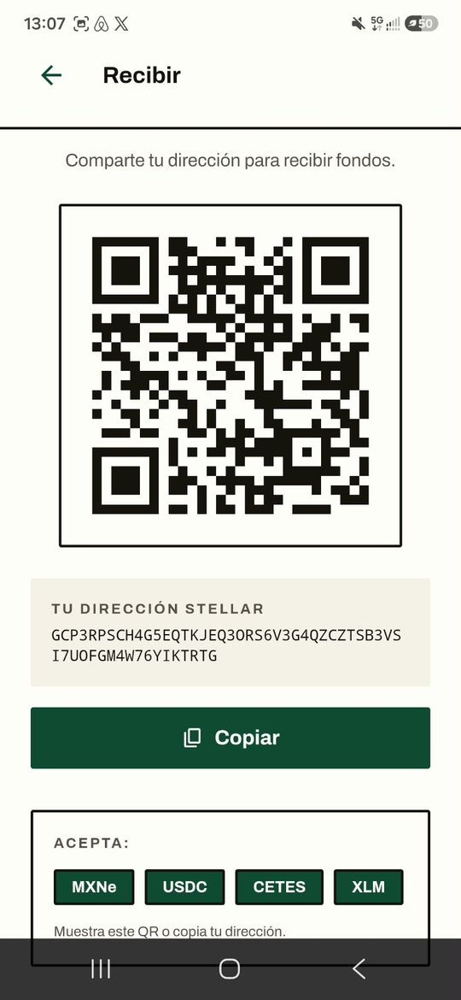 | 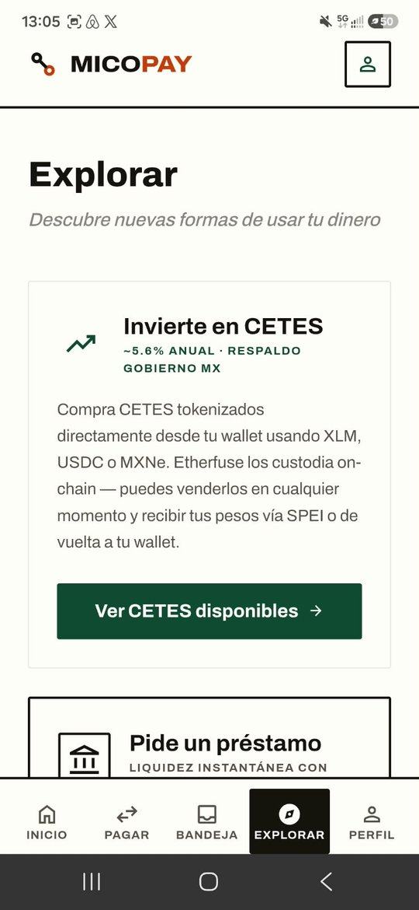 | 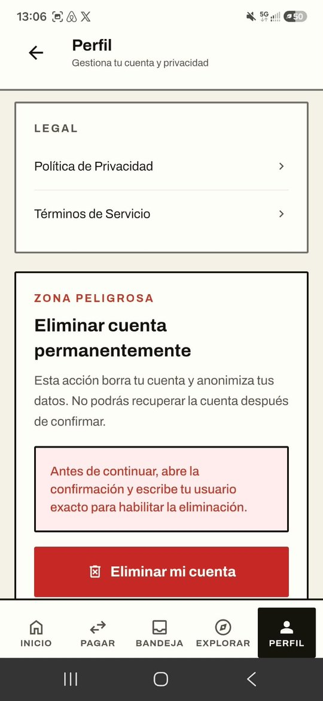 |

**Pantallas del flujo sin captura todavía:** confirmación (5), firma (6), chat (7), código QR (8), escaneo del comercio (9), intercambio completado (10), historial con una devolución (11) y ajuste de comisión del comercio (12). Para tomarlas hace falta un intercambio con dos cuentas: una como usuario y otra como agente con liquidez cerca.

### Cómo se conecta con la red y el backend

El front no mueve fondos por su cuenta. Pide al backend la transacción ya armada, la firma con la llave guardada en el teléfono y el backend la envía a Stellar. El escrow es un contrato en Soroban que bloquea, libera o devuelve los USDC según la regla escrita en el contrato. Las direcciones de la red, del contrato y del activo se configuran en `micopay/frontend/.env.testnet`, de modo que el mismo código sirve para testnet y, más adelante, para mainnet.

### Qué hay en el front que queda fuera del MVP

La app también tiene pantallas para depositar efectivo (cash-in), pagar y cobrar entre billeteras, verificar identidad y explorar productos de ahorro (CETES tokenizados y Blend). El Blueprint deja todo eso fuera del MVP. Las pantallas de ahorro funcionan en modo simulado, solo en builds de prueba, y no mueven fondos. No forman parte de esta entrega.

### Limitaciones conocidas

- Para pasar de la pantalla de inicio de sesión hace falta el backend. La versión de testnet usa el backend publicado del proyecto (`.env.testnet`).
- El historial de cada comercio se calcula hoy en la base de datos. Llevarlo a la red es parte del MVP.
- El tipo de cambio todavía no viene de una fuente en vivo.

---

## 2. Decisión técnica: contratos

**Opción elegida: A. Contrato propio.**

Según el Blueprint (sección 8), la red se usa para tres cosas: retener los USDC en un escrow que nadie puede tocar, que cada persona controle su propia llave y dejar un historial público de intercambios por comercio. La primera es la regla central del producto y es la que decide esta opción.

**Qué hace el contrato.** Es un escrow en Soroban con tres operaciones:

- **Bloquear:** al firmar la operación, los USDC del usuario quedan retenidos en el contrato junto con el comercio elegido, el monto y un plazo de vencimiento.
- **Liberar:** cuando el comercio escanea el QR de un solo uso al entregar el efectivo, el contrato le transfiere los USDC. Solo puede liberarse una vez y solo al comercio de esa operación.
- **Devolver:** si vence el plazo sin entrega, los USDC regresan al usuario sin que nadie tenga que aprobarlo.

Cada intercambio queda registrado en la red con su estado (bloqueado, completado, devuelto), y de ahí sale el historial público del comercio que pide el MVP.

**Por qué hace falta uno propio.** No encontramos una herramienta del ecosistema que haga esta regla exacta: retención atada a un QR de un solo uso, liberación en persona y devolución por tiempo. Adaptar un servicio genérico de pagos o de custodia significaría que un tercero retiene el dinero o que la regla vive en un servidor, y eso rompe la promesa del producto: que ni el usuario ni el comercio tengan que confiar primero en el otro, ni en nosotros. El equipo ya validó esta lógica con un contrato propio en testnet, con el que hicimos un retiro y un depósito de $500 MXN de punta a punta el 24 de septiembre y un ensayo del escrow en USDC el 7 de octubre.

**Qué se descarta.** La opción B para el escrow, por lo anterior. Las herramientas del ecosistema sí tienen lugar en otra pieza, la billetera del usuario, que no define la lógica del intercambio. Nuestra investigación marcó el respaldo de la llave secreta como la barrera más fuerte (V-4, V-22), y para resolverlo evaluamos dos opciones que se integrarían con el contrato propio, no en su lugar:

| Opción | Qué resuelve | Qué falta confirmar |
| --- | --- | --- |
| Smart wallets con passkeys (cuentas de contrato en Soroban, por ejemplo con passkey-kit) | Que el usuario entre y recupere su cuenta con la biometría de su teléfono, sin frase semilla. | Compatibilidad con el escrow, costo de despliegue por cuenta y soporte en Android con Capacitor. |
| Pollar (SDK de onboarding y activación de billeteras para Stellar) | Login social o por correo, creación y activación de la cuenta con comisiones patrocinadas, y soporte para passkeys y smart accounts. | Modelo de custodia (propia o co-firmada), soporte para React con Capacitor, autorización para llamar al escrow y costo. |

---

## 3. Participación del equipo

| Integrante | Usuario de GitHub | Aporte en esta entrega |
| --- | --- | --- |
| Eric Mota Tejeda | [@ericmt-98](https://github.com/ericmt-98) | Autor del prototipo en el que se basa el front y del contrato de escrow. Redactó la decisión técnica. |
| Raúl Vallejo | [@vallejoraul08-debug](https://github.com/vallejoraul08-debug) | [pendiente] |
| Anna Medina | [@annapats](https://github.com/annapats) | Integró la documentación de la semana 3 y las capturas de la app Android en testnet, y armó la copia del front con su README en el repositorio del curso (`Micopay/proyectobb101`). |
| José Alfredo Román Cruz | [pendiente] | [pendiente] |

---

## 4. Bloqueos y siguiente paso

- **Decisión de la billetera:** smart wallets con passkeys o Pollar. Bloquea el diseño del onboarding y del respaldo de la llave.
- **Publicar el front en Vercel** para que se pueda ver sin instalar nada.
- **Completar un intercambio de prueba con dos cuentas** (usuario y agente con liquidez cerca) para documentar las pantallas que van de la confirmación al intercambio completado. En la prueba del 15 de octubre no había agentes disponibles para $500 MXN.
- **Historial del comercio en la red:** hoy se calcula en la base de datos. El MVP pide llevarlo a Stellar.
- **Siguiente paso hacia el MVP:** con la decisión tomada, integrar la billetera elegida con el escrow de USDC en testnet y repetir el flujo completo con usuarios reales en pruebas asistidas.
