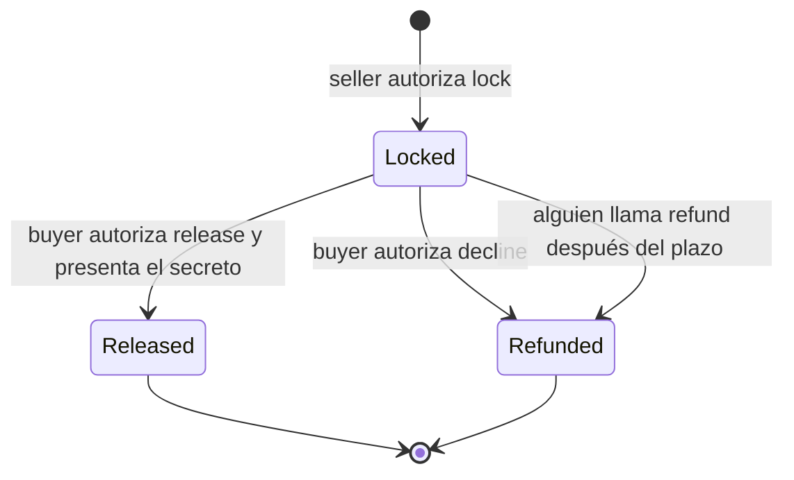

# Guía del código del contrato escrow de MicoPay

Esta guía explica el contrato Soroban que vive en
[`micopay/contracts/escrow`](../../micopay/contracts/escrow). Está pensada para
entender el código antes de modificarlo, auditarlo o desplegar una nueva
instancia.

## 1. Qué hace el contrato

El contrato funciona como una caja programable:

1. El `seller` bloquea un activo digital y la comisión mediante `lock`.
2. Mientras la operación está bloqueada, solo puede terminar de tres maneras:
   - `release`: el `buyer` presenta el secreto correcto y recibe el monto. La
     wallet de plataforma recibe la comisión.
   - `decline`: el `buyer` rechaza la operación y devuelve inmediatamente monto
     y comisión al `seller`.
   - `refund`: después del plazo, cualquier cuenta puede activar la devolución
     de monto y comisión al `seller`.
3. `get_trade` permite consultar el estado guardado en cadena.

El contrato protege el activo digital. No puede comprobar por sí mismo si el
efectivo se entregó en el mundo real.



## 2. Archivos principales

| Archivo | Responsabilidad |
|---|---|
| [`src/lib.rs`](../../micopay/contracts/escrow/src/lib.rs) | Lógica del contrato y funciones públicas |
| [`src/types.rs`](../../micopay/contracts/escrow/src/types.rs) | Estados, estructura de una operación y llaves de almacenamiento |
| [`src/errors.rs`](../../micopay/contracts/escrow/src/errors.rs) | Códigos de error públicos |
| [`src/test.rs`](../../micopay/contracts/escrow/src/test.rs) | Pruebas unitarias del ciclo de vida |
| [`Cargo.toml`](../../micopay/contracts/escrow/Cargo.toml) | Dependencias y configuración de compilación |

Orden recomendado de lectura: `types.rs`, `errors.rs`, `lib.rs` y finalmente
`test.rs`.

## 3. Tipos y datos guardados

### `TradeStatus`

```rust
pub enum TradeStatus {
    Locked,
    Released,
    Refunded,
}
```

- `Locked`: los fondos siguen dentro del contrato.
- `Released`: el monto fue entregado al `buyer` y la comisión a la plataforma.
- `Refunded`: el monto y la comisión regresaron al `seller`.

No existe un estado `Declined`. `decline` termina guardando `Refunded`; la
diferencia se conserva en el evento `declined` emitido por el contrato.

### `TradeEscrow`

Cada operación guarda:

| Campo | Significado |
|---|---|
| `seller` | Cuenta que bloquea el activo digital |
| `buyer` | Cuenta autorizada para ejecutar `release` o `decline` |
| `amount` | Monto comercial, en unidades mínimas del token |
| `platform_fee` | Comisión, también en unidades mínimas |
| `secret_hash` | SHA-256 del secreto que abre `release` |
| `timeout_ledger` | Número de ledger a partir del cual se permite `refund` |
| `status` | Estado terminal o bloqueado de la operación |

Los montos usan `i128`, no números decimales. Para un activo con siete
decimales, `10_000_000` representa una unidad.

### `DataKey`

```rust
pub enum DataKey {
    Admin,
    TokenId,
    PlatformWallet,
    Trade(BytesN<32>),
}
```

- `Admin`, `TokenId` y `PlatformWallet` son configuración de la instancia.
- `Trade(trade_id)` identifica cada operación persistente.

Cada instancia acepta un solo `token_id`. Por eso MicoPay despliega una
instancia para XLM y otra para USDC.

## 4. Errores públicos

`EscrowError` asigna un número estable a cada error. Los más relevantes son:

| Código | Error | Cuándo aparece |
|---:|---|---|
| 1 | `NotInitialized` | Falta configuración de token o wallet de plataforma |
| 3 | `TradeNotFound` | No existe el `trade_id` consultado |
| 4 | `InvalidSecret` | El secreto no produce el hash guardado |
| 5 | `TradeNotLocked` | Se intenta terminar una operación ya terminada |
| 6 | `TimeoutNotReached` | Se llama `refund` demasiado pronto |
| 9 | `InsufficientAmount` | `amount <= 0` o `platform_fee < 0` |
| 10 | `TradeAlreadyExists` | Ya se utilizó el mismo `secret_hash` |
| 11 | `AmountOverflow` | La suma de monto y comisión supera `i128` |

`AlreadyInitialized`, `TimeoutReached` y `Unauthorized` están definidos pero
la versión actual no los devuelve directamente. Las autorizaciones fallidas
las maneja Soroban mediante `require_auth()`.

## 5. Encabezado, módulos e importaciones

```rust
#![no_std]

mod errors;
mod types;
```

`#![no_std]` indica que el contrato no usa la biblioteca estándar de Rust. Un
contrato WASM debe ser pequeño y ejecutarse dentro del entorno controlado de
Soroban.

Las importaciones principales son:

- `Env`: acceso al ledger, almacenamiento, criptografía y eventos.
- `Address`: cuenta o contrato Stellar.
- `Bytes` y `BytesN<32>`: secreto y hashes de 32 bytes.
- `token::Client`: transferencias del activo configurado.
- `contract` y `contractimpl`: convierten la estructura Rust en contrato
  Soroban.

## 6. Vida útil del almacenamiento

```rust
const TTL_MIN: u32 = 17_280;
const TTL_EXTEND: u32 = 518_400;
```

Soroban puede archivar entradas que dejan vencer su TTL. El contrato renueva:

- la configuración de la instancia;
- la operación que se acaba de crear, cambiar o leer.

Los valores equivalen aproximadamente a un umbral de un día y una extensión a
30 días, suponiendo cerca de cinco segundos por ledger. No son una garantía de
tiempo de pared exacta.

Una lectura mediante `get_trade` también renueva el TTL de esa operación.

## 7. Cómo se calcula `trade_id`

```rust
fn compute_trade_id(
    env: &Env,
    _seller: &Address,
    _buyer: &Address,
    secret_hash: &BytesN<32>,
) -> BytesN<32>
```

Aunque la firma conserva parámetros para `seller` y `buyer`, sus nombres
empiezan con `_` porque actualmente no participan en el cálculo. El ID es:

```text
trade_id = sha256(secret_hash)
secret_hash = sha256(secret)
```

Esto tiene dos objetivos:

1. La simulación y la ejecución real calculan exactamente la misma llave de
   almacenamiento.
2. El mismo `secret_hash` no puede reutilizarse dentro de una instancia.

Antes de transferir fondos, `lock` verifica si ya existe
`DataKey::Trade(trade_id)`. Así evita que alguien sobrescriba una operación
existente usando el hash público y un monto mínimo.

Consecuencia práctica: cada operación debe generar un secreto criptográfico
nuevo y aleatorio.

## 8. Estructura del contrato

```rust
#[contract]
pub struct EscrowFactory;

#[contractimpl]
impl EscrowFactory {
    // funciones públicas
}
```

`EscrowFactory` no contiene campos Rust. El estado real vive en el
almacenamiento de Soroban. `#[contractimpl]` expone los métodos siguientes como
funciones invocables en cadena.

## 9. Constructor

```rust
pub fn __constructor(
    env: Env,
    admin: Address,
    token_id: Address,
    platform_wallet: Address,
)
```

El constructor se ejecuta de forma atómica al desplegar la instancia:

1. Guarda `admin`.
2. Guarda el token que esa instancia puede mover.
3. Guarda la wallet que recibirá comisiones.
4. Extiende el TTL de la instancia.

El `admin` queda registrado, pero la versión actual no contiene funciones
administrativas que lo utilicen. Tampoco existe una función para cambiar token
o wallet después del despliegue. Cambiar esos valores requiere desplegar una
nueva instancia o añadir una migración administrativa explícita.

## 10. `lock`: bloquear fondos

Firma simplificada:

```rust
lock(seller, buyer, amount, platform_fee, secret_hash, timeout_minutes)
    -> trade_id
```

La función ejecuta estos pasos en orden:

1. `seller.require_auth()` exige autorización del dueño de los fondos.
2. Rechaza montos no positivos y comisiones negativas.
3. Lee el `token_id` configurado.
4. Calcula el `trade_id`.
5. Rechaza un ID ya existente.
6. Suma `amount + platform_fee` mediante `checked_add`.
7. Transfiere el total del `seller` al contrato.
8. Convierte minutos a un ledger absoluto con `timeout_minutes * 12`.
9. Guarda un `TradeEscrow` en estado `Locked`.
10. Renueva TTL, publica `locked` y devuelve el ID.

La suma comprobada evita que un desbordamiento convierta un monto grande en un
valor diferente. La configuración de release también mantiene
`overflow-checks = true`.

El plazo se mide en ledgers, no con el reloj del teléfono ni con la hora de la
base de datos. `timeout_minutes` es una aproximación basada en 12 ledgers por
minuto.

## 11. `release`: completar con éxito

Firma:

```rust
release(trade_id, secret)
```

Flujo:

1. Carga la operación.
2. Exige que siga en `Locked`.
3. Exige autorización del `buyer` guardado.
4. Calcula `sha256(secret)` y lo compara con `secret_hash`.
5. Transfiere `amount` del contrato al `buyer`.
6. Transfiere `platform_fee` a `platform_wallet`, si es mayor que cero.
7. Cambia el estado a `Released`.
8. Renueva TTL y publica `released`.

El secreto por sí solo no basta. También debe autorizar la cuenta exacta que
fue registrada como `buyer`.

Una vez guardado `Released`, cualquier nuevo `release`, `decline` o `refund`
falla con `TradeNotLocked`.

## 12. `decline`: cancelación temprana

Firma:

```rust
decline(trade_id)
```

`decline` permite devolver fondos sin esperar el timeout:

1. Carga la operación y verifica `Locked`.
2. Exige autorización del `buyer`.
3. Suma monto y comisión con protección de desbordamiento.
4. Devuelve el total al `seller`.
5. Guarda el estado `Refunded`.
6. Publica el evento `declined`.

No comprueba el timeout. Funciona antes o después del plazo, siempre que la
operación continúe bloqueada y el `buyer` autorice.

En el producto, esta ruta debe ofrecerse antes de la constancia durable de
entrega de efectivo. El contrato no puede observar esa entrega por sí mismo,
por lo que sigue existiendo un riesgo conocido si el `buyer` invoca `decline`
directamente después de entregar efectivo.

## 13. `refund`: recuperación después del plazo

Firma:

```rust
refund(trade_id)
```

Flujo:

1. Carga la operación y verifica `Locked`.
2. Compara el ledger actual con `timeout_ledger`.
3. Si todavía no vence, devuelve `TimeoutNotReached`.
4. Devuelve monto y comisión al `seller`.
5. Guarda `Refunded` y publica `refunded`.

No llama `require_auth()`. Es una función permissionless: cualquier cuenta
puede enviar la transacción después del plazo, pero los fondos siempre regresan
al `seller` almacenado. El llamador no puede redirigirlos.

Cumplir el plazo no mueve fondos automáticamente. Alguien debe llamar
`refund`; el backend de MicoPay hace ese trabajo mediante su barrido de
reembolsos.

## 14. `get_trade`: lectura del estado

```rust
get_trade(trade_id) -> TradeEscrow
```

Devuelve la estructura completa o `TradeNotFound`. Además renueva el TTL de la
instancia y de esa operación. No mueve tokens ni cambia el estado comercial.

## 15. Transferencias de tokens

El contrato crea un cliente del token configurado:

```rust
let token_client = token::Client::new(&env, &token_id);
```

Las direcciones de las transferencias son:

| Función | Origen | Destino | Cantidad |
|---|---|---|---|
| `lock` | `seller` | contrato | `amount + platform_fee` |
| `release` | contrato | `buyer` | `amount` |
| `release` | contrato | `platform_wallet` | `platform_fee` |
| `decline` | contrato | `seller` | `amount + platform_fee` |
| `refund` | contrato | `seller` | `amount + platform_fee` |

El contrato nunca envía fondos al backend.

## 16. Autorizaciones

| Función | Quién debe autorizar | Motivo |
|---|---|---|
| `lock` | `seller` | Sacar sus tokens y bloquearlos |
| `release` | `buyer` | Confirmar la salida al buyer usando el secreto |
| `decline` | `buyer` | Rechazar y devolver antes del timeout |
| `refund` | Nadie específico | El destino está fijado y el plazo protege la operación |
| `get_trade` | Nadie | Solo lectura |

`require_auth()` no significa que el backend confíe en un campo de texto. La
autorización debe formar parte de la transacción Soroban firmada por la cuenta
correspondiente.

## 17. Eventos

Los eventos permiten que backend, indexadores y herramientas de soporte
reconcilien la base de datos con la cadena:

| Evento | Momento |
|---|---|
| `locked` | Fondos transferidos al contrato |
| `released` | Monto y comisión distribuidos |
| `declined` | Devolución autorizada por el buyer |
| `refunded` | Devolución posterior al timeout |

La base de datos no debe marcar `refunded` solamente porque alguien presionó
cancelar. Primero debe existir una transacción confirmada o un evento en cadena.

## 18. Propiedades de seguridad

El diseño actual garantiza:

- Solo el `seller` puede autorizar el bloqueo de sus fondos.
- Solo el `buyer` elegido puede ejecutar `release` o `decline`.
- `release` exige tanto firma como secreto.
- `refund` no puede cambiar el destinatario.
- La misma operación no puede terminar dos veces.
- El mismo `secret_hash` no puede sobrescribir una operación anterior.
- Las sumas críticas usan `checked_add`.
- Los fondos y la comisión permanecen juntos hasta conocer el resultado.

El contrato no garantiza:

- que el efectivo se entregó realmente;
- que el backend ejecute `refund` exactamente al vencer;
- que el valor en moneda local sea justo;
- que una identidad KYC corresponda físicamente a quien entrega efectivo;
- resolución de disputas o reputación.

Esas responsabilidades pertenecen a la aplicación, el backend y el futuro
sistema de disputas.

## 19. Qué prueban los tests

La suite actual contiene nueve casos:

1. `lock` seguido de `release`, incluyendo pago de comisión.
2. `refund` después del timeout.
3. `decline` antes del timeout.
4. `decline` después del timeout.
5. `decline` es terminal frente a las tres salidas.
6. Rechazo de desbordamiento en monto + comisión.
7. Rechazo de un secreto incorrecto.
8. Rechazo de `refund` antes del timeout.
9. Rechazo de un `secret_hash` reutilizado sin dañar la operación original.

`setup_env()` crea cuentas, registra un token de prueba, entrega saldo al
`seller` y despliega el contrato mediante el constructor.

`env.mock_all_auths()` simplifica las firmas en pruebas unitarias. Estas pruebas
validan reglas y saldos, pero no sustituyen una prueba de transacción firmada en
Testnet. Los despliegues y ensayos reales se documentan en
[`micopay/contracts/TESTNET.md`](../../micopay/contracts/TESTNET.md).

## 20. Configuración de compilación

`Cargo.toml` usa:

- `soroban-sdk = 25.3.2`;
- `cdylib` para producir WASM;
- optimización por tamaño con `opt-level = "z"`;
- LTO y una sola unidad de generación;
- símbolos de depuración eliminados;
- `panic = "abort"`;
- comprobación de desbordamiento activada en release.

El perfil `release-with-logs` hereda de release, pero conserva aserciones de
depuración para diagnósticos.

## 21. Puntos que deben revisarse antes de cambiar el contrato

1. **Compatibilidad:** añadir o cambiar argumentos modifica el contrato que
   esperan backend y APK.
2. **Nueva instancia:** el código de un contrato desplegado no se actualiza por
   editar el repositorio; normalmente se publica WASM y se despliega una nueva
   instancia.
3. **Un contrato por activo:** XLM y USDC deben conservar IDs separados.
4. **Estados terminales:** cualquier función nueva debe impedir doble pago.
5. **Autorización:** decidir explícitamente quién firma y por qué.
6. **Eventos:** toda salida de fondos necesita un evento reconciliable.
7. **TTL:** cada nueva entrada persistente debe renovar su vida útil.
8. **Pruebas:** cubrir éxito, permisos, tiempo, repetición y saldos finales.
9. **Integración:** actualizar mapeos del backend, validación de XDR, frontend,
   documentación de despliegue y APK.

## 22. Resumen mental

- `lock` mete monto y comisión en la caja.
- `release` abre la caja a favor del `buyer` con firma y secreto.
- `decline` la devuelve temprano al `seller` con firma del `buyer`.
- `refund` la devuelve tarde al `seller` después del timeout.
- `get_trade` permite comprobar qué ocurrió.

La regla más importante para la aplicación es sencilla: el estado de la base de
datos describe intención; una transacción confirmada en Stellar describe dónde
está realmente el dinero.
